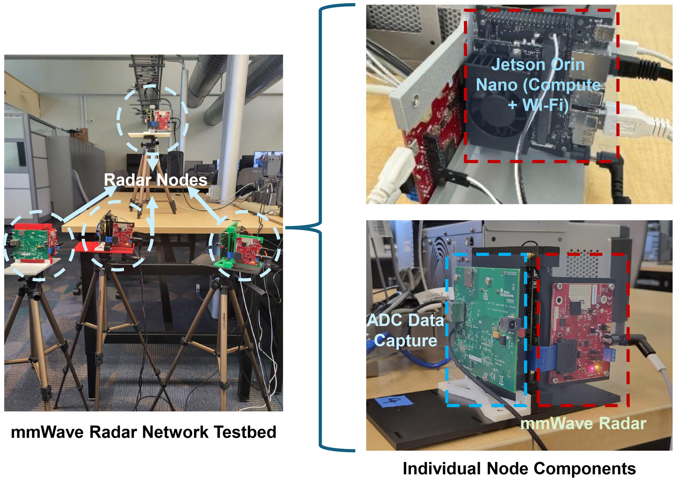
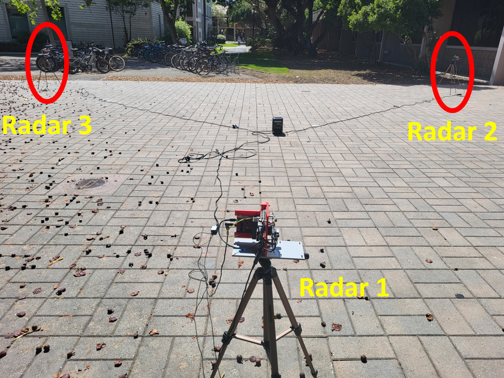
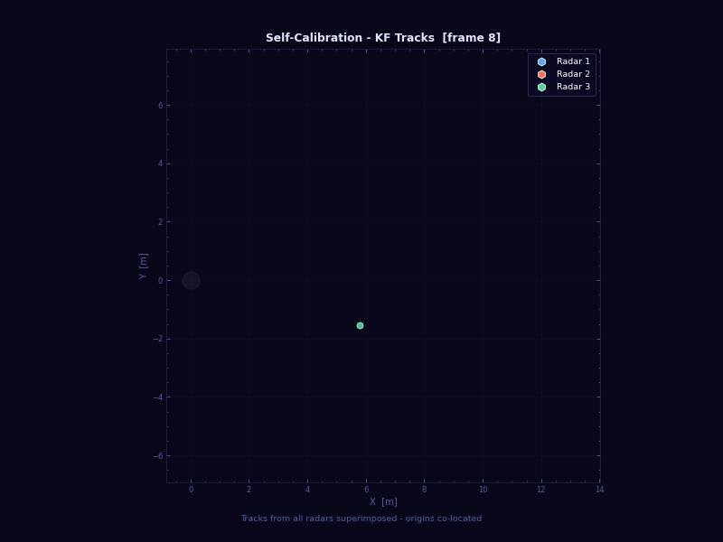

# NetRadar

**An open-source networked mmWave radar testbed.** Several radar nodes (TI AWR2243 +
NVIDIA Jetson) capture frames on a shared, clock-synchronized trigger and send what
they see to a fusion center. The fusion center works out where every radar is and
shows all of their targets together in one view.

   
  <em>Our four-node testbed. Each node pairs an NVIDIA Jetson Orin Nano with a TI DCA1000EVM capture card and a TI AWR2243BOOST radar.</em>

<table>
  <tr>
    <td width="50%" align="center">
       
      <em>The setup: three radars in a courtyard at UC Santa Barbara.</em>
    </td>
    <td width="50%" align="center">
       
      <em>Self-calibration: NetRadar figures out where each radar is and which way it faces, and the tracks line up.</em>
    </td>
  </tr>
</table>

Everything you need to build your own testbed:

| Repository | |
| :--- | :--- |
| [**NetRadar-Node**](https://github.com/NetRadar-Testbed/NetRadar-Node) | Software for each radar node: real-time processing, trigger and installer |
| [**NetRadar-FusionCenter**](https://github.com/NetRadar-Testbed/NetRadar-FusionCenter) | The server side: MQTT broker, time sync, self-calibration, dashboard and database |
| [**Documentation**](https://netradar-testbed.github.io) | Step-by-step guide, from an empty network to a calibrated testbed |

**Using NetRadar in your research?** Please cite our papers, and mention in your paper
that your testbed was built with NetRadar. The references are on the
[Citing NetRadar](https://netradar-testbed.github.io/citing/) page.

Contributions are welcome! Please fork the repository, make your changes on a branch
and open a pull request against `main`. More details in
[CONTRIBUTING.md](https://github.com/NetRadar-Testbed/.github/blob/main/CONTRIBUTING.md).

NetRadar was developed as part of the **Chirp Capstone Project 2025–2026 at the University of
California, Santa Barbara**, by William Ni, Oviya Seeniraj, Andrey Otvagin, Vihan Jayaraman,
Jason Wang and Anirban Banik, mentored by Anirban Banik and advised by Professors Upamanyu
Madhow and Yogananda Isukapalli. It is released under the Apache-2.0 licence.
